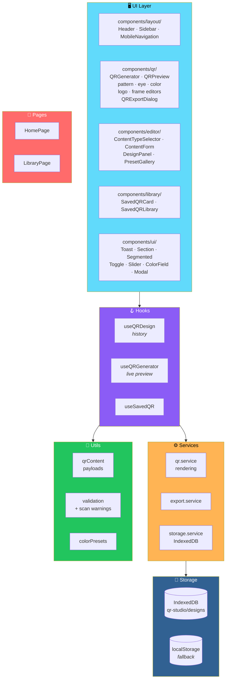

# 🔳 QR Studio

<div align="center">


**A premium QR code generator and designer.**

*A QR code should look as good as the brand it represents — and scan every time.*

[✨ Features](#-features) • [🚀 Installation](#-installation) • [🛡️ Scan Safety](#-how-scannability-is-protected) • [🏗️ Architecture](#-project-structure) • [🔒 Privacy](#-privacy)

</div>

---

## 📖 Overview

**QR Studio** is a **premium QR code generator and designer**.

Paste a link, Wi-Fi details, a contact card — or any other content — **then style the code in real time** and download **crisp PNG, JPG, or SVG files**.

### Core Idea

> **Everything runs in the browser — no account, no backend, no uploads.**
>
> **A QR code should look as good as the brand it represents AND scan every time.**

### The Design Loop

```mermaid
flowchart LR
    Content["📝 Pick a content type<br/>Website · Wi-Fi · Text<br/>Contact · Social"] --> Form["📋 Fill the form<br/><em>validated</em>"]
    Form --> Preview["👁️ Live preview<br/><em>real-time</em>"]
    Preview --> Style["🎨 Style<br/>patterns · colors<br/>logo · frame"]
    Style --> Presets["⚡ Apply a preset<br/><em>10 one-click designs</em>"]
    Presets --> Check["🛡️ Scan checker<br/>contrast · logo size<br/>inverted colors"]
    Check --> Export["📤 Export<br/>PNG · JPG · SVG"]
    Export --> Library["📚 Save to library<br/><em>IndexedDB</em>"]

    style Content fill:#61DAFB,color:#000
    style Form fill:#8B5CF6,color:#fff
    style Preview fill:#FFB454,color:#000
    style Style fill:#FF6B6B,color:#fff
    style Presets fill:#FFD700,color:#000
    style Check fill:#22C55E,color:#fff
    style Export fill:#0EA5E9,color:#fff
    style Library fill:#0f3460,color:#fff
```



---

## ✨ Features

### 📝 Content Types

<div align="center">

| Type | Payload |
|:----:|---------|
| **🌐 Website** | URL |
| **📶 Wi-Fi** | **Standard `WIFI:` payload with proper escaping** |
| **📄 Text** | **Multiline** |
| **📧 Email** | Email + subject + body |
| **📞 Phone** | Phone number |
| **💬 SMS** | Number + message |
| **💚 WhatsApp** | Number + message |
| **📍 Location** | Coordinates |
| **👤 Contact** | **vCard 3.0** |
| **📱 Social** | **Facebook · Instagram · TikTok · YouTube · Telegram** |

</div>

> ✅ **Each content type has its own validated form.**

### 🎨 Design Studio

<div align="center">

| Category | Options |
|:--------:|---------|
| **🔲 Module Patterns** | **6 styles** — square · rounded · dots · extra-rounded · classy · elegant |
| **👁️ Eyes** | **Independent eye frame and eye center styles** *(square, rounded, circular)* · **optional custom eye colors** |
| **🎨 Code Colors** | **Solid · linear-gradient · radial-gradient** with **up to 4 stops** · **professional palettes** |
| **🖼️ Backgrounds** | **Solid · gradient · soft-pastel · transparent** |
| **🏷️ Center Logo** | **Drag-and-drop upload** · **size slider** · **white (or any color) backing** · **rounded container** |
| **🖼️ Frame** | **Border** · **"Scan me" / custom label** · **font choice** · **colors and sizes** |
| **⚡ 10 One-Click Presets** | **Minimal Black · Midnight Blue · Luxury Gold · Soft Pastel · Ocean Blue · Neon Purple · Forest Green · Modern Gradient · Rose Pink · Elegant White** |
| **↩️ Undo / Redo** | **`Ctrl/Cmd+Z` · `Ctrl/Cmd+Shift+Z`** · **one-click undoable reset** |

</div>

### 📤 Export

<div align="center">

| Format | Options |
|:------:|---------|
| **PNG** | **1024 / 2048 / 4096 px** — **transparent, white, or custom background** |
| **JPG** | **Adjustable quality** |
| **SVG** | **Pure vector** |

</div>

**Choose whether to include:**

- Title
- Description
- Frame

> ✅ **Exports are rendered FRESH at the requested resolution** — **they are NEVER screenshots of the preview.**

### 📚 Library

- **Save, rename, duplicate, delete**
- **Search and categorize designs**
- **Edit any saved design to reopen it exactly as you left it**

### 🛡️ Scan Safety

> **A live checker warns about:**
>
> - **Low contrast**
> - **Inverted colors**
> - **Low-contrast custom eyes**
> - **Oversized logos**

---

## 🛠️ Technology Stack

<div align="center">

| Library | Role |
|:-------:|------|
| **React 18** | UI |
| **TypeScript** | Language |
| **Vite** | Build tool |
| **Tailwind CSS** | Styling |
| **lucide-react** | Icons |
| **`qr-code-styling`** | QR rendering |
| **`qrcode-generator`** | **Module count for exact quiet zones** |
| **`file-saver`** | Downloads |
| **IndexedDB** | Library storage |

</div>

---

## 🚀 Installation

**Requires Node.js 18 or newer.**

```bash
npm install
npm run dev        # http://localhost:5173
```

### 🛠️ Development Commands

<div align="center">

| Command | What It Does |
|:-------:|--------------|
| **`npm run dev`** | Start the Vite dev server with hot reload |
| **`npm run typecheck`** | Type-check the whole project |
| **`npm test`** | Run the payload / validation sanity checks |
| **`npm run build`** | Type-check and build to `dist/` |
| **`npm run preview`** | Serve the production build locally |

</div>

### 📦 Production Build

```bash
npm run build
npm run preview
```

> ✅ **The output in `dist/` is a fully static site and can be hosted anywhere.**

### 🔺 Deploying to Vercel

**Three steps:**

1. **Push the project to GitHub, GitLab, or Bitbucket**
2. In Vercel choose **Add New → Project** and import the repository
3. **Vercel detects Vite automatically** — **confirm: build command `npm run build`, output directory `dist`** — **click Deploy**

**Or with the CLI:**

```bash
npm i -g vercel && vercel --prod
```

> ✅ **No environment variables are needed.**
>
> **The app uses hash-based navigation (`#/library`), so no rewrite rules are required.**

---

## 🛡️ How Scannability Is Protected

> **This is what separates QR Studio from a QR generator that just looks nice.**

<div align="center">

| Protection | Implementation |
|:----------:|---------------|
| **📏 Quiet Zone** | **The EXACT module count is calculated for each payload** — **and a 4-module margin is applied on EVERY side, as the QR specification requires** |
| **🛡️ Error Correction** | ***Auto* uses level Q** — **and level H whenever a logo is present** — **you can override it** |
| **🎨 Contrast** | **Measured (WCAG ratio) across EVERY gradient stop** — **warnings below 3.5:1** — **errors below 2:1** |
| **🏷️ Logo Size** | **Capped at 35% of the width** — **warnings above 25%** |
| **📐 Proportions** | **The code is ALWAYS rendered square at an integer pixel size** — **never stretched** |
| **👁️ Preview = Export** | **The live preview and every download use the SAME renderer** |

</div>

### ⚠️ Test Before Printing

> **Always test a finished design with a couple of real phones before printing at scale** — **in particular for gradients, custom eye colors, and logos.**

---

## 🏗️ Architecture

### System Overview



### 📂 Project Structure

```
qr-studio/
├── public/
│   └── favicon.svg
│
├── scripts/
│   └── check-payloads.ts        payload + validation checks (npm test)
│
├── src/
│   ├── components/
│   │   ├── layout/              Header · Sidebar (category filter)
│   │   │                        MobileNavigation
│   │   ├── qr/                  QRGenerator (workspace) · QRPreview
│   │   │                        pattern / eye / color / logo / frame editors
│   │   │                        QRExportDialog
│   │   ├── editor/              ContentTypeSelector · ContentForm
│   │   │                        DesignPanel · PresetGallery
│   │   ├── library/             SavedQRCard · SavedQRLibrary
│   │   └── ui/                  Toast · shared controls
│   │                            (Section, Segmented, Toggle, Slider,
│   │                             ColorField, Modal)
│   │
│   ├── hooks/                   useQRDesign (history)
│   │                            useQRGenerator (live preview)
│   │                            useSavedQR
│   │
│   ├── services/                qr.service (rendering)
│   │                            export.service
│   │                            storage.service (IndexedDB)
│   │
│   ├── utils/                   qrContent (payloads)
│   │                            validation (+ scan warnings)
│   │                            colorPresets
│   │
│   ├── types/
│   │   └── qr.types.ts
│   │
│   ├── pages/                   HomePage · LibraryPage
│   │
│   ├── App.tsx · main.tsx · index.css
│
├── index.html
├── package.json
├── tsconfig.json
├── vite.config.ts
└── tailwind.config.js
```

### Design Principles

<div align="center">

| Principle | Implementation |
|:---------:|---------------|
| **🔒 Privacy by architecture** | **No backend, no analytics, no tracking** — **your URLs, Wi-Fi passwords, contacts, and logos are processed entirely in your browser** |
| **🛡️ Scannability is protected, not assumed** | **Exact module count · 4-module margin · contrast ratio across every gradient stop · logo size cap · never stretched** |
| **👁️ Preview = Export** | **The live preview and every download use the SAME renderer** |
| **📤 Exports are fresh** | **Rendered at the requested resolution** — **NEVER screenshots of the preview** |
| **📚 Library is yours** | **IndexedDB — data never leaves your device** |
| **🎨 Design is data** | **Content, design settings, payload, and thumbnail all stored together** — **edit any saved design to reopen it exactly as you left it** |
| **💾 Graceful fallback** | **If IndexedDB is unavailable, QR Studio falls back to `localStorage`** |

</div>

---

## 💾 Browser Storage

> **Saved designs are stored in IndexedDB** *(database `qr-studio`, object store `designs`)* **inside your browser.**

### Each Record Holds

- **The content you entered**
- **The full design settings** *(including an uploaded logo as a data URL)*
- **The generated payload**
- **A small preview thumbnail**

### ⚠️ Important Notes

<div align="center">

| Note | Details |
|:----:|---------|
| **🔒 Data never leaves your device** | **Not shared across browsers or devices** |
| **🗑️ Clearing site data or using a private window removes saved designs** | |
| **🔽 Fallback** | **If IndexedDB is unavailable, QR Studio falls back to `localStorage`** *(smaller quota)* |
| **📥 Download your images** | **They are your backup** |

</div>

---

## 🔒 Privacy

<div align="center">

| Guarantee | Details |
|:---------:|---------|
| **No backend** | None |
| **No analytics** | None |
| **No tracking** | None |
| **Your URLs, Wi-Fi passwords, contacts, and logos** | **Processed entirely in your browser — NEVER uploaded** |
| **Network requests** | **Only for its own static files and the Google Fonts used for typography** |

</div>

> ⚠️ **Note that a QR code is just encoded text** — **anyone who scans a Wi-Fi or contact code can read what is inside it.**

---

## 🗺️ Roadmap

### ✅ Current

- [x] React 18 + TypeScript + Vite foundation
- [x] Tailwind CSS styling with lucide-react icons
- [x] `qr-code-styling` rendering with `qrcode-generator` for exact module count
- [x] **10 content types** — Website, Wi-Fi, Text, Email, Phone, SMS, WhatsApp, Location, Contact (vCard 3.0), Social
- [x] **Validated form for each content type**
- [x] **Standard `WIFI:` payload with proper escaping**
- [x] **6 module patterns** — square, rounded, dots, extra-rounded, classy, elegant
- [x] **Independent eye frame and center styles** with optional custom eye colors
- [x] **Solid, linear-gradient, and radial-gradient code colors** with up to 4 stops
- [x] **Professional palettes**
- [x] **Solid, gradient, soft-pastel, and transparent backgrounds**
- [x] **Center logo with drag-and-drop upload** — size slider, white or any color backing, rounded container
- [x] **Frame, border, label, font, colors, and sizes**
- [x] **10 one-click presets**
- [x] **Undo / redo** with keyboard shortcuts and one-click undoable reset
- [x] **PNG export** at 1024 / 2048 / 4096 px with transparent, white, or custom background
- [x] **JPG export** with adjustable quality
- [x] **Pure-vector SVG export**
- [x] **Choose whether to include title, description, and frame**
- [x] **Fresh rendering at requested resolution** — never screenshots of the preview
- [x] **Library** — save, rename, duplicate, delete, search, categorize
- [x] **Edit any saved design to reopen it exactly as you left it**
- [x] **Live scan checker** — low contrast, inverted colors, low-contrast custom eyes, oversized logos
- [x] **Exact module count with 4-module margin on every side**
- [x] **Auto error correction** — level Q, or level H when a logo is present, with manual override
- [x] **WCAG contrast measurement across every gradient stop** — warnings below 3.5:1, errors below 2:1
- [x] **Logo size capped at 35%** with warnings above 25%
- [x] **Square rendering at integer pixel size — never stretched**
- [x] **Preview and export use the same renderer**
- [x] **IndexedDB storage** under `qr-studio/designs`
- [x] **`localStorage` fallback** when IndexedDB is unavailable
- [x] **Hash-based navigation** — no server rewrite rules required
- [x] **Vercel deployment** with automatic Vite detection
- [x] **Static build** deployable to any host
- [x] **No backend, no analytics, no tracking, no uploads**
- [x] **Payload and validation sanity checks** via `npm test`

### 🔜 Future Ideas

- [ ] **Additional content types** — beyond the current 10
- [ ] **Bulk QR generation** — CSV import to generate many codes
- [ ] **Additional presets** beyond the current 10
- [ ] **Custom pattern editor** — build your own module shapes
- [ ] **SVG path customization** — edit the output in a vector tool
- [ ] **Cloud sync** *(opt-in)* — for library across devices
- [ ] **PWA support** — install and use offline
- [ ] **Localization** — bilingual UI
- [ ] **Print-optimized export** — with crop marks
- [ ] **AR preview** — see the code in situ via camera

---

## 🤝 Contributing

Contributions are welcome. Please:

1. Fork the repository
2. **Keep it backend-free** — no server, no accounts, no analytics
3. **Keep scannability protected** — quiet zones, contrast checks, and logo limits are not optional
4. **Keep the module count exact** — `qrcode-generator` exists for this reason
5. **Keep exports fresh** — never screenshot the preview
6. **Keep preview and export using the same renderer**
7. **Keep the library local** — IndexedDB with a `localStorage` fallback
8. **Preserve hash-based navigation** — it's why no rewrite rules are needed
9. **Test generated codes with a real phone** before submitting any design change
10. Submit a Pull Request

### Guidelines

- **Never remove the quiet zone**
- **Never stretch the code** — always square, always integer pixels
- **Never lower the contrast thresholds**
- **Never allow a logo above the size cap**
- **Never upload user content** — everything is processed in the browser
- **Never present a stub as a feature**

---

## 📜 License

**MIT** — see [LICENSE](LICENSE) for details.

---

## 🙏 Acknowledgments

- **`qr-code-styling`** — for making beautiful QR codes possible
- **`qrcode-generator`** — for the exact module count that makes quiet zones precise
- **Every brand that's ever needed a QR code they weren't embarrassed by** — this one's for you

---

<div align="center">

### 🔳 DESIGN. STYLE. EXPORT. SCAN.

**A premium QR code generator and designer.**

**Beautiful AND scannable. Never one without the other.**

<br>

> 🛡️ **Exact quiet zones. Contrast-checked. Logo-capped. Preview equals export.**

<br>

⭐ If QR Studio helped you make a QR code you're proud of, consider giving it a star.

<br>

[⬆ Back to Top](#-qr-studio)

</div>
